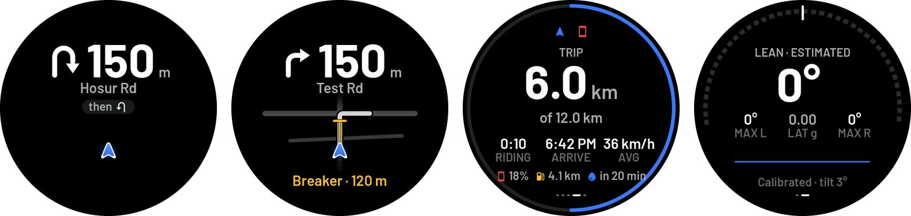

# BikePod

A DIY navigation pod for a motorcycle handlebar: a round 2.8" touch screen that shows the next turn, a live street map, trip, lean and g-force, calls and music, all driven by an iPhone over Bluetooth LE.

<p align="center">
  
</p>

The phone does the thinking: search, routing, turn-by-turn guidance and GPS. The pod is an instrument: it receives small text messages and draws screens you can read at a glance. It's powered by the bike and handles ignition-off and stalls gracefully.

## Features

**On the pod**
- **Turn screen:** a big arrow and distance, the road name, a closing ring, and arrival time and kilometres left. Arrows cover left, right, straight, U-turns, and roundabouts with the exit drawn at its real angle and numbered.
- **"Then" hint:** shows the turn after next when it comes right after.
- **Live street map:** a heading-up map under the route, drawn by a custom anti-aliased rasteriser that follows the rider smoothly, plus fuel stations and a line up to the next speed breaker.
- **Trip page:** distance, riding time, arrival, average speed, phone battery, the next fuel station and minutes until rain on the route.
- **Lean and g-force:** lean angle with left and right maximums, lateral and longitudinal g, and peak values. The pod calibrates itself at power-on and remembers how it's mounted.
- **Calls and music:** the incoming caller's name and missed calls (Apple ANCS). Now playing shows the title, artist, position and album art (Apple AMS plus art from the app).
- **Ride summary on arrival:** distance, time, average and top speed, lean and peak g.
- **Display and reliability:** auto-dimming at night, brightness settings and a "waiting for phone" screen. If the link goes quiet, the pod fades the screen and recovers on its own.

**In the iPhone app**
- Place search, route options sorted fastest first, and turn-by-turn navigation with voice.
- Rerouting, plus a ride simulation for testing at 1×, 4× or 10× speed.
- Ride history: each ride's track, speeds, maximum lean and peak g.
- A Live Activity on the lock screen and Dynamic Island (optional, off by default to save battery).
- Speed breakers and fuel stations along the route from OpenStreetMap, and rain ahead from Open-Meteo.

## How it works

```
iPhone app (Swift)                                    Pod (ESP32-S3, C++)
──────────────────                                    ───────────────────
Photon search ─┐                                      BLE GATT server
Valhalla route ┼─ Ferrostar guidance ── text lines ──▶ parse ─▶ LVGL screens
GPS / simulator┘   map tiles (OpenFreeMap)  over BLE   map rasteriser, ring, pages
Overpass, Open-Meteo                                  IMU (lean, g), ANCS/AMS
```

Messages are short UTF-8 lines, for example `L|400|MG Rd` (turn left in 400 m), `POSE|7|120,-405,853` (rider position in map area 7) or `TRIP|18:42|6.0|7.3|1440`. The full list is in [`firmware/pod/BLE_Link.h`](firmware/pod/BLE_Link.h). The phone sends map areas of about 500 m around the rider, decoded from vector tiles, and the pod draws them itself.

## Hardware

- [Waveshare ESP32-S3-Touch-LCD-2.8C](https://docs.waveshare.com/ESP32-S3-Touch-LCD-2.8C): round 480×480 ST7701 RGB panel, GT911 touch, QMI8658 IMU, PCF85063 RTC, 16 MB flash, 8 MB PSRAM.
- Power from the bike over USB-C, from a fused 12 V → 5 V supply or the bike's USB socket. There's no battery: the board can only estimate charge to about ±10%.
- Optional: an ML-2020 rechargeable coin cell so the clock survives power-off.

## Repository layout

| Path | What it is |
|---|---|
| `firmware/pod/` | Pod firmware (Arduino sketch): screens, map rasteriser, BLE link, IMU, phone notifications |
| `firmware/lvgl_conf/lv_conf.h` | The LVGL configuration the firmware needs (see below) |
| `firmware/LVGL_Arduino/` | Waveshare's board demo, kept as a hardware reference |
| `ios/BikePod/` | iPhone app (SwiftUI), its Live Activity widget, and the XcodeGen `project.yml` |
| `tools/pod_screenshot.py` | Captures the pod's screen over USB as a PNG |
| `tools/perf/` | Replays a recorded ride into the pod over USB and profiles it |
| `docs/` | Images for this README |

## Building

### Pod firmware

1. Install the Arduino ESP32 board package **3.0.2** (newer versions aren't tested) and **LVGL 8.3.10**.
2. Copy `firmware/lvgl_conf/lv_conf.h` into the LVGL library's `src/` folder. It puts LVGL's 128 KB memory pool in PSRAM, and the pod halts without it.
3. Build and upload:

```bash
arduino-cli compile --fqbn "esp32:esp32:esp32s3:PSRAM=opi,FlashSize=16M,PartitionScheme=app3M_fat9M_16MB" firmware/pod
```

```bash
arduino-cli upload -p /dev/cu.usbmodemXXXX --fqbn "esp32:esp32:esp32s3:PSRAM=opi,FlashSize=16M,PartitionScheme=app3M_fat9M_16MB" firmware/pod
```

The serial port (921600 baud) accepts test commands, such as `page 1`, `msg R|150|Test Rd`, `perf` and `fakecall Name`. They're listed in [`firmware/pod/Screenshot.cpp`](firmware/pod/Screenshot.cpp).

### iPhone app

Requires Xcode and [XcodeGen](https://github.com/yonaskolb/XcodeGen); iOS 17 or later.

```bash
cd ios/BikePod && APPLE_DEVELOPER_TEAM_ID=<your team id> xcodegen generate
```

Then open `BikePod.xcodeproj` and run the app on a device. Bluetooth doesn't work in the Simulator, but simulated rides do. In the Simulator, the app records the lines it would send the pod to `Documents/podfeed.log`, which `tools/perf/replay.py` can play into a real pod.

## Credits

- Map data © [OpenStreetMap](https://www.openstreetmap.org/copyright) contributors.
- Routing by [Valhalla](https://github.com/valhalla/valhalla) (public FOSSGIS server), guidance by [Ferrostar](https://github.com/stadiamaps/ferrostar), maps by [MapLibre](https://maplibre.org) with [OpenFreeMap](https://openfreemap.org) tiles.
- Search by [Photon](https://photon.komoot.io), points of interest from [Overpass](https://overpass-api.de), weather from [Open-Meteo](https://open-meteo.com).
- UI built with [LVGL](https://lvgl.io), [Barlow](https://github.com/jpt/barlow) fonts (OFL) and [Material Icons](https://fonts.google.com/icons) (Apache 2.0).

Personal project, not affiliated with any of the above. Ride safely: set the route before you ride, and treat lean and g figures as for interest only.
